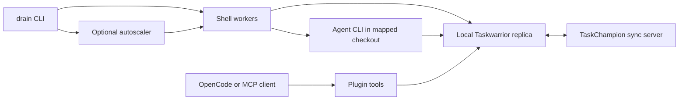

# Architecture and execution boundaries

## Components

| Component | Responsibility |
|---|---|
| `drain` | CLI parsing, background launch, stop controls, project listing/merge |
| `task-drain.sh` | Queue selection, claims, agent prompt/invocation, outcome recording, dashboard, autoscaling |
| `lib/worker-detect.sh` | Host process discovery and worker identity parsing |
| `lib/display.sh` | Terminal formatting shared by dashboards |
| `plugin/src/task.mjs` | Taskwarrior subprocess adapter, validation, lifecycle guards |
| `plugin/src/tools.ts` | Shared definitions of 22 tools |
| `plugin/src/index.ts` | OpenCode v2 plugin adapter |
| `plugin/src/mcp-server.ts` | MCP stdio adapter exposing `task_*` tools |
| `install.sh` | Dependency setup, optional sync container, script symlinks, plugin build |

Taskwarrior owns task data. TaskChampion synchronizes replicas. The plugin
and shell workers invoke Taskwarrior separately; neither calls the other.
Worker state under `~/.task-drain/` belongs to the OS user and is shared
across projects and Taskwarrior profiles.

## Worker lifecycle

1. Check the primary-host guard (`worker.primary_host` / `DRAIN_PRIMARY_HOST`;
   refuse unless `DRAIN_ALLOW_OTHER_HOST=1`), executable dependencies, and
   STOP state; abort if the initial sync fails. Reclaim provably abandoned
   host-local locks left by SIGKILLed workers.
2. In retry mode, snapshot eligible failed-task UUIDs into a per-worker file.
3. Before each selection, release active `drain-claimed` tasks older than
   `STALE_AFTER_SEC` whose recorded local worker PID is dead (`kill -0`
   check). The candidate scan covers all projects but releases only this
   host's claims; it cannot detect death on other hosts, and PID reuse is
   only guarded for the host-local lock layer (see below), not for claim
   annotations. Also sweep abandoned task/repo lock dirs: only locks with
   full owner metadata proving abandonment (dead PID, or PID-reuse proven
   by process-start mismatch on the same host) and older than
   `DRAIN_LOCK_GRACE_SEC` are removed; live, young, partial, cross-host,
   and legacy-live locks are kept (fail closed).
4. Normal mode exports the eligible set and selects greatest urgency. Retry
   mode consumes its snapshot, rechecking pending, failed, and idle state.
5. Acquire the host-local per-task and per-repo locks (with one safe
   reclaim-and-retry when the holder is provably stale), then add
   `drain-claimed`, annotate, start the task, and sync the claim before
   invoking the agent. Failed claim publication skips execution and attempts
   to release the claim.
6. Run one agent in the mapped directory (or HOME if unresolved), with stdin
   closed. A background annotator records progress approximately every 30s.
7. After the agent exits, attempt sync and inspect task status. Success
   requires status `completed` **and** agent exit code 0; otherwise record
   failure, add `drain-failed`, release the claim, and attempt sync. A
   failed completion sync stops the worker (fail closed) rather than
   recording an unconfirmed outcome. The shell runs no acceptance tests
   and validates no commits or PRs.
8. Repeat; an empty queue causes exit unless `DRAIN_PERSIST=1`. The empty
   path attempts sync but does not reselect before a nonpersistent exit.

Sync is bounded: each attempt is capped by `DRAIN_SYNC_TIMEOUT_SEC`
(default 30s), retried at most `DRAIN_SYNC_RETRIES` times (default 3) with
exponential backoff from `DRAIN_SYNC_RETRY_DELAY` (floor 1s), and the waits
are SIGTERM-interruptible (an in-flight sync child is killed on shutdown).
Failures are logged as temporary (network/server, retryable) or permanent
(auth/config, needs operator action); required sync failures abort the
operation and a task is never executed when its claim cannot be published.

The completed path does not explicitly remove `drain-claimed`. History is
a rolling TSV with timestamp, UUID, project, description, result, elapsed
seconds, and worker ID. Concurrent append/prune operations are not locked;
it is an operator convenience, not a durable audit log.

## Enforced behavior versus agent instructions

The shell enforces selection filters, initial/claim sync checks, and a
wall-clock limit **only when `gtimeout` is found**. It does not independently
run acceptance tests, validate evidence, check PR creation, require human
approval, or parse the agent's final `DONE:`/`FAILED:` line.

The prompt asks the agent to verify work, use feature branches, commit, push,
open a PR, and defer owner decisions. These are behavioral instructions,
not authorization controls. Agent permissions, credentials, hooks, and
repository instructions determine what execution can actually do.

There is no blanket offline guarantee: completion sync failures are ignored
before status inspection, and the autoscaler uses local state on sync failure.
The plugin fails a tool call on sync errors, but a failed post-write sync
can leave local mutations applied. None of these operations is transactional.

## Concurrency and isolation

- Selection and claim are separate operations without a distributed lock or
  compare-and-swap. On one host, simultaneous workers are serialized by a
  host-local per-task lock (`~/.task-drain/locks/<uuid>`) with verifiable
  owner identity (PID + hostname + process start time), so two local
  workers cannot execute the same task; abandoned locks are reclaimed
  automatically under fail-closed rules (live, young, partial, cross-host,
  and legacy-live locks are never removed). Across hosts there is no mutual
  exclusion: two machines whose pre-claim syncs both predate the other's
  published claim will each run an agent on the same task. A published claim
  narrows this window but does not provide exactly-once execution.
  **Autonomous execution is therefore single-host: run workers or a
  supervisor on at most one machine.** An optional fail-closed guard
  exists: set `worker.primary_host` (or `DRAIN_PRIMARY_HOST`) to the
  designated host and every `drain start` / `drain autoscale` / worker /
  supervisor elsewhere refuses unless `DRAIN_ALLOW_OTHER_HOST=1` is set
  explicitly. This prevents *accidental* multi-host deployment, not a
  deliberate second launch with the override set. True prevention of
  concurrent multi-host execution requires an external coordination
  primitive (atomic CAS/lease); TaskChampion sync does not provide one, and
  no client-side post-claim verification can close the race.
  A plugin `claim`/`start` with `force:true` alone can no longer take over
  a `drain-claimed` task; an explicit `overrideDrainClaim:true` plus an
  auditable `overrideReason` (recorded as a `[actor] drain-override:`
  annotation) is required. Never override drain-owned tasks while
  autonomous workers run except for deliberate administrative recovery.
- Workers use the mapped checkout directly and do not create worktrees.
  Drain workers serialize Git operations per repository with a host-local
  lock, so two drain workers never run agents in the same checkout
  concurrently. Plugin-driven or interactive work in the same checkout is
  unsynchronized: different tasks can still change the same working tree
  concurrently. Use isolated mappings and tasks deliberately.
- Stale reclamation can release a still-running task, especially when the
  task timeout is disabled or longer than the stale threshold.
- Retry snapshots and consumption are per worker. With multiple workers,
  the same task can be retried more than once across the pool.
- Stop controls are host-local. They do not stop workers on other machines
  sharing the same TaskChampion pool. TERM cleanup is best-effort; hard kills,
  detached descendants, or sync failures can leave work or claims behind.
- The autoscaler counts host processes matching the script path whose recorded
  project filter matches its own (file-backed worker registry), not just
  workers for its project. Its one PID file is shared across project runs:
  only one supervisor runs per host, and a second `drain autoscale` (any
  project) is rejected while it is alive. Liveness is verified by PID plus
  command-line identity, so PID reuse by an unrelated process can neither
  block startup nor cause a kill; a transient `autoscale.starting` mutex
  serializes concurrent launches. The supervisor tracks the workers it
  spawns and reaps exited ones each loop iteration, so terminated workers
  never accumulate as zombies and the running count stays accurate;
  reaping only waits on supervisor-spawned PIDs and never signals anyone.

## Plugin and worker coexistence

Plugin ownership is `claimed` plus `[actor] claimed:` annotations; workers
use `drain-claimed` plus `claimed by drain-...` annotations. They are different
protocols. The worker eligibility filter excludes `claimed`,
`drain-claimed`, `ready-for-review`, `review`, and `approved` tags in both
pickup modes, so shell workers do not pick up plugin-owned or in-review tasks.

For an interactive task withheld from both shell pickup modes, add `noauto`
and remove `auto` before releasing active work. Plugin `task_auto` does not
honor those worker tags. Explicitly select UUIDs when mixing workflows.

Plugin actors are caller-provided annotation labels, not authenticated
identities. Approval tools do not establish that a human approved anything.
`task_complete` requires `+approved` (use `approve` first); `force:true`
bypasses the approval check but requires a `note`. See [tool semantics](plugin-tools.md).

## Data and network access

Task descriptions, annotations, and repository context are given to the
configured agent and may be sent to its model provider. Taskwarrior contacts
the configured sync server; PR discovery contacts GitHub via `gh`; optional
error webhooks receive diagnostic details. There is no separate analytics
collector in this repository. Logs and task annotations can contain sensitive
context; retain and share them accordingly.
